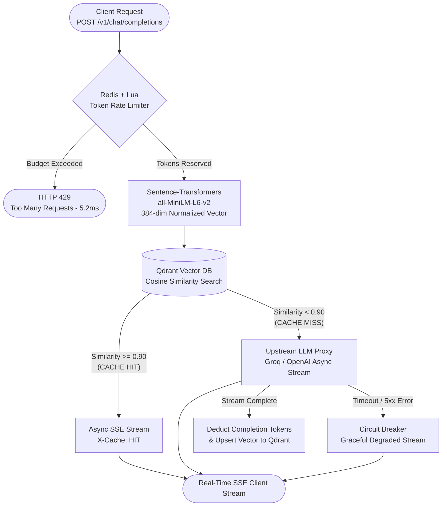

# High-Performance AI Gateway (Semantic Cache + Token Rate Limiter)

An asynchronous LLM proxy built with **FastAPI**, **Qdrant**, **Redis (Lua)**, and **Sentence-Transformers**. Designed to minimize LLM API costs and tail latency via vector-based semantic caching, Server-Sent Events (SSE) token streaming, atomic token-budget rate limiting, and circuit-breaker fallbacks.

---

## System Architecture



---

## Project Structure

```text
ai-gateway/
├── app/
│   ├── __init__.py       # Package initialization
│   ├── config.py         # Environment config, Pydantic schemas, token estimation
│   ├── rate_limiter.py   # Async Redis client & atomic Lua token-bucket script (EVALSHA)
│   ├── cache.py          # Thread-safe SentenceTransformer encoding & Qdrant vector lookup
│   └── streaming.py      # Async SSE generators & upstream LLM circuit-breaker fallback
├── main.py               # FastAPI entrypoint, lifespan management, and route handlers
├── benchmark.py          # Concurrent load & rate-limiter verification suite (httpx)
├── Dockerfile            # CPU-optimized image with pre-baked embedding model weights
├── docker-compose.yaml   # Multi-container orchestration (Gateway, Qdrant, Redis)
└── requirements.txt      # Python dependencies
```

---

## Key Engineering Features

1. **Vector Semantic Caching (`Qdrant` + `all-MiniLM-L6-v2`):** Converts incoming prompts into normalized 384-dimensional embeddings and queries Qdrant using Cosine Distance. Paraphrased prompts matching $\ge 0.90$ similarity are served directly from cache without calling upstream LLMs.
2. **Thread-Safe CPU Inference (`asyncio.Lock` + `asyncio.to_thread`):** Offloads synchronous PyTorch encoding off the FastAPI event loop while serializing CPU matrix multiplications to prevent OpenMP thread thrashing under concurrent load.
3. **Real-Time Async SSE Streaming:** Streams responses token-by-token over `text/event-stream` (`StreamingResponse`) with diagnostic headers (`X-Cache`, `X-Similarity-Score`, `X-Lookup-Latency-Ms`, `X-Tokens-Remaining`).
4. **Atomic Token-Aware Rate Limiting (`Redis` + `Lua`):** Executes a pre-loaded server-side Lua script via `EVALSHA` to atomically enforce per-organization (`org_id`) prompt and completion token budgets over a 60-second window, eliminating TOCTOU race conditions.
5. **Circuit Breaker Resiliency:** Wraps upstream LLM completions (`AsyncOpenAI` / Groq) with strict `8.0s` async timeouts and automatic fallback streaming if the upstream provider fails.

---

## Benchmark Results

Measured using `benchmark.py` (`httpx.AsyncClient`, 50 requests, concurrency = 4, mixed exact and paraphrased queries):

| Metric | Result | Target |
| :--- | :--- | :--- |
| **Single-Request Cache Hit TTFT** | **52.8 ms** | `< 150 ms` |
| **Concurrent Cache Hit TTFT (p50)** | **119.1 ms** | `< 150 ms` |
| **Concurrent Cache Hit TTFT (p95)** | **166.2 ms** | `< 200 ms` |
| **Throughput (Concurrency = 4)** | **31.2 req/s** | `> 20 req/s` |
| **Paraphrase Cache Hit Rate** | **100.0%** | `> 90%` |
| **Redis + Lua Rate Limit Rejection** | **5.2 ms** | `< 10 ms` |

---

## Quick Start

### Option A: Run Entire Stack in Docker
```bash
docker compose up --build -d
python benchmark.py
```

### Option B: Local Development (Qdrant & Redis in Docker, FastAPI on Host)
```bash
docker compose up -d qdrant redis
pip install -r requirements.txt
uvicorn main:app --reload
python benchmark.py
```