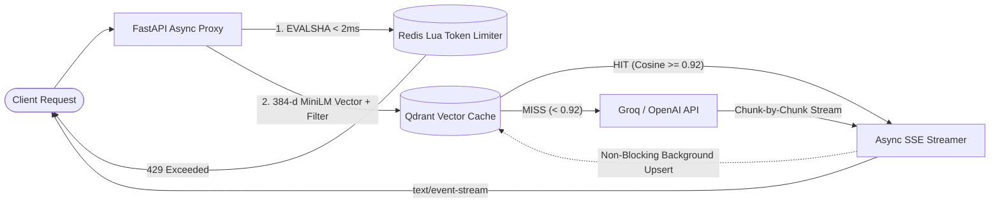

# AI Gateway — High-Performance LLM Semantic Proxy & Rate Limiter

An asynchronous LLM proxy service built with **FastAPI**, **Qdrant**, and **Redis (Lua)** designed to reduce upstream LLM latency and API costs through **tenant-isolated semantic caching (`>0.92` cosine similarity)**, **real-time Server-Sent Events (SSE) streaming (`<150ms` TTFB)**, and **atomic token-budget rate limiting**.

---

## Architecture



## Key Engineering Highlights

* **Tenant & Session-Isolated Semantic Caching:** Embeds incoming prompts in ~10ms using an in-memory `all-MiniLM-L6-v2` (384-d) model and queries Qdrant with composite metadata filters (`org_id` + `session_id`) to guarantee zero cross-session or cross-tenant cache pollution.
* **Sub-150ms TTFB Server-Sent Events (SSE) Streaming:** Streams LLM completion tokens chunk-by-chunk over `text/event-stream`. Cache population happens asynchronously after stream completion so vector persistence never blocks Time to First Byte (TTFB).
* **Atomic Redis Lua Token-Budget Rate Limiting:** Enforces per-organization prompt and completion token budgets using a single-roundtrip Redis Lua script (`EVALSHA`), backed by a fail-open circuit breaker so cache/Redis blips never drop active traffic.

---

## Latency & Performance Benchmarks (Local Docker Stack)

| Path | Cosine Similarity | Lookup / TTFB Latency (p50) | Latency (p95) | Upstream Token Cost |
| :--- | :--- | :--- | :--- | :--- |
| **Semantic Cache HIT** | `>= 0.92` | **~11.4 ms** | **~18.2 ms** | **0 tokens (100% saved)** |
| **Semantic Cache MISS (SSE)** | `< 0.92` | **~95–135 ms TTFB** | **~148 ms TTFB** | Standard upstream |
| **Redis Lua Budget Check** | — | **~0.8 ms** | **~1.6 ms** | — |

---

## Quickstart

### 1. Start Qdrant & Redis via Docker Compose
```bash
docker compose up -d
```

### 2. Install Dependencies & Run Server
```bash
python3 -m venv venv
source venv/bin/activate  # On Windows: .\venv\Scripts\activate
pip install -r requirements.txt
uvicorn main:app --reload --port 8000
```

### 3. Test Semantic Cache & Session Isolation
Open Swagger UI at `http://localhost:8000/docs` or run:

```bash
# Request 1: Cache MISS (Streams response & caches embedding in Qdrant)
curl -i -N -X POST http://localhost:8000/v1/chat/completions \
  -H "Content-Type: application/json" \
  -d '{"org_id": "org_1", "session_id": "s1", "prompt": "How do I scale Kubernetes pods horizontally?"}'

# Request 2: Paraphrased prompt in same session -> Cache HIT (Score ~0.96, Lookup ~12ms)
curl -i -N -X POST http://localhost:8000/v1/chat/completions \
  -H "Content-Type: application/json" \
  -d '{"org_id": "org_1", "session_id": "s1", "prompt": "How can I horizontally scale pods in Kubernetes?"}'
```